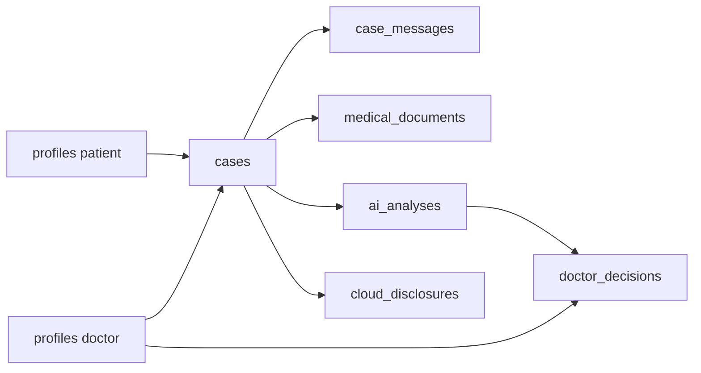

# MedFlow — schema DB (Supabase PostgreSQL)

Sursa: `migrations/001_initial_schema.sql`  
Identitate + date medicale în același proiect; accesul medical trece prin Backend (`service_role`). Gemini nu vede tabelele astea — doar text pseudonimizat.

## Grafic relații

```mermaid
erDiagram
  auth_users ||--|| profiles : "id"
  profiles ||--o{ doctor_patient_assignments : "doctor_id"
  profiles ||--o{ doctor_patient_assignments : "patient_id"
  profiles ||--o{ medical_records : "patient_id"
  profiles ||--o{ cases : "patient_id"
  profiles ||--o{ cases : "doctor_id"
  profiles ||--o{ doctor_decisions : "doctor_id"

  cases ||--o{ case_messages : "case_id"
  cases ||--o{ medical_documents : "case_id"
  cases ||--o{ ai_analyses : "case_id"
  cases ||--o{ doctor_decisions : "case_id"
  cases ||--o{ cloud_disclosures : "case_id"
  ai_analyses ||--o| doctor_decisions : "ai_analysis_id"

  auth_users {
    uuid id PK
  }

  profiles {
    uuid id PK_FK
    text full_name
    text role "patient | doctor"
    timestamptz created_at
  }

  doctor_patient_assignments {
    uuid id PK
    uuid doctor_id FK
    uuid patient_id FK
    boolean is_active
    timestamptz created_at
  }

  medical_records {
    uuid id PK
    uuid patient_id FK
    text record_type
    jsonb clinical_data
    timestamptz created_at
  }

  cases {
    uuid id PK
    uuid patient_id FK
    uuid doctor_id FK
    text status
    timestamptz created_at
    timestamptz updated_at
  }

  case_messages {
    uuid id PK
    uuid case_id FK
    text sender_role
    text content
    timestamptz created_at
  }

  medical_documents {
    uuid id PK
    uuid case_id FK
    text document_type
    jsonb extracted_data
    timestamptz created_at
  }

  ai_analyses {
    uuid id PK
    uuid case_id FK
    text model_name
    text case_summary
    jsonb symptoms
    text urgency
    jsonb follow_up_questions
    jsonb proposed_options
    text status
    timestamptz created_at
  }

  doctor_decisions {
    uuid id PK
    uuid case_id FK
    uuid doctor_id FK
    uuid ai_analysis_id FK
    text decision_type
    text final_response
    timestamptz created_at
  }

  cloud_disclosures {
    uuid id PK
    uuid case_id FK
    text provider
    text model_name
    text payload_hash
    timestamptz created_at
  }
```

## Flux pe caz



## Statusuri & enum-uri

| Tabel | Câmp | Valori |
|-------|------|--------|
| `profiles` | `role` | `patient`, `doctor` |
| `cases` | `status` | `draft`, `awaiting_patient`, `pending_doctor`, `approved`, `closed` |
| `case_messages` | `sender_role` | `patient`, `doctor`, `ai`, `system` |
| `doctor_decisions` | `decision_type` | `approved`, `modified`, `custom`, `rejected` |

## Note scurte

- `doctor_patient_assignments`: o singură alocare **activă** per pereche doctor–pacient.
- `medical_documents`: doar metadata extrasă (fără imagini/PDF în MVP).
- `ai_analyses.proposed_options`: până la 3 propuneri pentru medic, nu diagnostic direct către pacient.
- `cloud_disclosures`: metadata cloud (`payload_hash`), fără payload PII brut.
- RLS ON pe toate tabelele app; fără politici publice; grant pe `service_role`.
