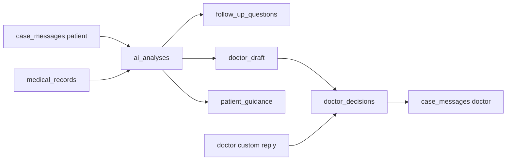

# MedFlow — schema DB (Supabase PostgreSQL)

**Migrations:** `001_initial_schema.sql` → `002_post_consultation_fixes.sql` → `003_doctor_orchestration_state.sql` → `004_auth_connections.sql` → `005_auth_code_validation.sql` → `006_auth_lock_order.sql`  
Apply in order via Supabase SQL Editor. Do not re-edit applied migrations; add new ones.

**Backend (current):** MedFlow-Backend is **Node.js + Express** and uses `SUPABASE_SECRET_KEY` (service role). That key **bypasses RLS**, so FastAPI/Express authorization checks are mandatory on every medical request. Intended long-term stack may include Python + FastAPI; the security rule is the same.

Identitate + date medicale în același proiect. Gemini nu vede tabelele — doar text pseudonimizat din gateway.

## Grafic relații

```mermaid
erDiagram
  auth_users ||--|| profiles : "id"
  profiles ||--o{ doctor_patient_assignments : "doctor_id"
  profiles ||--o{ doctor_patient_assignments : "patient_id"
  profiles ||--o{ medical_records : "patient_id"
  profiles ||--o{ cases : "patient_id"
  profiles ||--o{ cases : "doctor_id"
  profiles ||--o{ doctor_decisions : "doctor_id"
  profiles ||--o{ medical_documents : "uploaded_by"

  cases ||--o{ case_messages : "case_id"
  cases ||--o{ medical_documents : "case_id"
  cases ||--o{ ai_analyses : "case_id"
  cases ||--o{ doctor_decisions : "case_id"
  cases ||--o{ cloud_disclosures : "case_id"
  ai_analyses ||--o| doctor_decisions : "ai_analysis_id"
  case_messages ||--o{ ai_analyses : "summarized_until_message_id"

  auth_users {
    uuid id PK
  }

  profiles {
    uuid id PK_FK
    text full_name
    text role "patient | doctor"
    timestamptz created_at
  }

  doctor_patient_assignments {
    uuid id PK
    uuid doctor_id FK
    uuid patient_id FK
    boolean is_active
    timestamptz created_at
  }

  medical_records {
    uuid id PK
    uuid patient_id FK
    text record_type
    jsonb clinical_data
    timestamptz created_at
  }

  cases {
    uuid id PK
    uuid patient_id FK
    uuid doctor_id FK
    text status
    jsonb doctor_orchestration_state "nullable (003)"
    timestamptz created_at
    timestamptz updated_at
  }

  case_messages {
    uuid id PK
    uuid case_id FK
    text sender_role
    text content
    timestamptz created_at
  }

  medical_documents {
    uuid id PK
    uuid case_id FK
    uuid uploaded_by FK
    text document_type
    text mime_type
    bigint size_bytes
    jsonb extracted_data
    jsonb review
    uuid reviewed_by FK
    timestamptz reviewed_at
    timestamptz created_at
  }

  ai_analyses {
    uuid id PK
    uuid case_id FK
    text model_name
    text case_summary
    jsonb symptoms
    jsonb context_relevance
    text patient_guidance
    text doctor_draft
    uuid summarized_until_message_id FK
    text urgency
    jsonb follow_up_questions
    jsonb proposed_options
    text status
    timestamptz created_at
  }

  doctor_decisions {
    uuid id PK
    uuid case_id FK
    uuid doctor_id FK
    uuid ai_analysis_id FK
    text decision_type
    text final_response
    timestamptz created_at
  }

  cloud_disclosures {
    uuid id PK
    uuid case_id FK
    text provider
    text model_name
    text payload_hash
    timestamptz created_at
  }
```

## Flux post-consultație (MVP)



1. Mesajele pacientului se salvează cronologic în `case_messages`.
2. AI produce sumar (`case_summary`), simptome (`symptoms`), relevanță istoric (`context_relevance`), întrebări (`follow_up_questions`), ghidaj general (`patient_guidance`), draft opțional (`doctor_draft`).
3. `summarized_until_message_id` marchează până unde a fost citit chat-ul.
4. Medicul aprobă/editează draft-ul sau scrie independent (`decision_type = 'custom'`, `ai_analysis_id` nullable).
5. AI **nu** diagnostichează / nu prescrie; urgența e etichetă organizațională, nu diagnostic.

## Statusuri & enum-uri

| Tabel | Câmp | Valori |
|-------|------|--------|
| `profiles` | `role` | `patient`, `doctor` |
| `cases` | `status` | `draft`, `awaiting_patient`, `pending_doctor`, `approved`, `closed` |
| `case_messages` | `sender_role` | `patient`, `doctor`, `ai`, `system` |
| `doctor_decisions` | `decision_type` | `approved`, `modified`, `custom`, `rejected` |
| `medical_documents` | `document_type` | `prescription`, `lab_result`, `medical_letter`, `other` |
| `medical_documents` | `mime_type` | `application/pdf`, `image/png`, `image/jpeg` (sau NULL pe rânduri vechi) |
| `ai_analyses` | `status` | `pending` (default), `completed`, `failed` |
| `ai_analyses` | `urgency` | `routine`, `review_required`, `potential_emergency` (nullable) |

### Urgency vocabulary

La review (2026-11-06) **MedFlow-AI** nu definește un contract partajat pentru `urgency` (are `redFlagsDetected` separat pe edge).  
Vocabularul de mai sus este **organizațional** (triage intern pentru medic), **nu** diagnostic autonom.  
Escaladarea critică necesită reguli explicite (ex. `edge/safety/redflags.ts`) + validare medicală — nu doar output LLM.

Coordonare: dacă AI/Backend adoptă alte string-uri, actualizați CHECK-ul într-o migrare nouă **înainte** de a scrie valori incompatibile.

### `proposed_options`

Păstrat din 001 ca **legacy / optional**. Workflow-ul post-consultație **nu** cere 3 propuneri de diagnostic. Câmpurile noi de sumar/draft acoperă MVP-ul.

### `cases.doctor_orchestration_state` (003)

Starea orchestratorului AI pentru medic (`DoctorOrchestrator` din MedFlow-AI), păstrată între request-uri HTTP.
Fiecare rundă de clarificare e un request separat la `POST /cases/:id/analysis`, deci contorul de runde trebuie salvat în DB.

| Valoare | Înseamnă |
|---------|----------|
| `NULL` | Nu s-a cerut încă nicio analiză AI pentru caz (runda 0) |
| `{"sessionId": "<case id>", "roundCount": 0..2, "lastAnalysis": {...}}` | Analiza e în curs; `lastAnalysis` = ultimul răspuns AI (pe date **scrubbed**) |

- CHECK: dacă nu e `NULL`, trebuie să fie obiect JSON (`jsonb_typeof = 'object'`).
- Scrisă/citită **doar** de Backend (`src/orchestrationStateStore.ts`), cu cheia service_role.
- **Nu** se trimite pacientului: `GET /cases/:id` nu selectează coloana.

## medical_documents (upload metadata)

| Coloană | Note |
|---------|------|
| `document_type` | **Categorie medicală**, nu extensie fișier |
| `mime_type` | Tipul fișierului original (MVP MIME-uri de mai sus) |
| `size_bytes` | Dimensiune ≥ 0; nullable pe legacy |
| `uploaded_by` | FK → `profiles.id`; rolul = `profiles.role` |
| `extracted_data` | Ce a citit serviciul de extragere (neschimbat după verificare); poate conține greșeli de citire |
| `review` | (migrarea 008) Verificarea pacientului: `{fields, medications}`; `NULL` = neverificat. Doar medicamentele din documente verificate intră în „Tratament activ” |
| `reviewed_by` / `reviewed_at` | (008) pacientul care a verificat și momentul |

Backend **trebuie** să populeze metadata la fiecare upload nou și să verifice că uploader-ul are acces la caz (pacientul cazului sau medicul asignat).  
Stocarea fișierelor / OCR nu fac parte din schema DB MVP.

## Authorization (Backend) — nu e enforce-uit pe rol în DB

FK-urile garantează doar că `profiles` există. **DB nu verifică** dacă `doctor_id` e doctor sau `patient_id` e pacient.

Backend trebuie să verifice la fiecare request relevant:

- `doctor_id` → `profiles.role = 'doctor'`
- `patient_id` → `profiles.role = 'patient'`
- medicul are `doctor_patient_assignments` activă pentru pacient
- accesul la caz / documente / decizii respectă asignarea

Hardening viitor (opțional): trigger/CHECK pe rol — **nu** în MVP 24h.

Cheia secretă Supabase bypass RLS → **nu sări** peste autorizarea din Backend.

## Securitate

### Google identity and doctor connections (004)

Migration 004 adds four tables without changing existing medical records:

| Table | Responsibility |
| --- | --- |
| `doctor_details` | Operator-approved specialty and clinic for a doctor profile |
| `doctor_invitations` | Normalized exact email, professional details, SHA-256 token hash, seven-day expiry, revocation and single-user consumption |
| `doctor_connection_codes` | One current 32-byte random hex code per doctor; rotation replaces it atomically |
| `connection_requests` | Separate `pending`, `accepted`, `rejected`, `cancelled` requests; one pending request per doctor/patient pair |

These tables have enabled and forced RLS, no policies or direct grants for
`anon`/`authenticated`, and service-role grants for trusted administration.
Existing medical table grants stay unchanged. Apply migration 004 as the Supabase
migration owner (`postgres`); its narrowly granted `SECURITY DEFINER` functions
use an empty search path and fully qualified application relations.

Account API calls use the user's JWT, not a service-role key. PostgreSQL derives
the identity from `auth.uid()`, checks confirmed `auth.users.email` plus a Google
identity in `auth.identities`, and provisions a patient using insert-on-conflict.
User metadata is display-only and cannot choose a role. Existing profiles are
preserved. Only consuming a matching operator-created invitation promotes the
same profile to doctor; professional details come from that invitation.

| RPC | Execute grant | JSON response |
| --- | --- | --- |
| `medflow_get_me()` | authenticated | `{profile}` |
| `medflow_accept_doctor_invitation(p_token text)` | authenticated | `{profile}` |
| `medflow_preview_doctor(p_code text)` | anon, authenticated | `{doctor}`; professional information only |
| `medflow_list_connection_requests()` | authenticated | `{requests}`; caller's role and participation filter |
| `medflow_request_connection(p_code text)` | authenticated patient | `{request, created}`; backend removes internal creation marker |
| `medflow_update_connection(p_id uuid, p_action text)` | authenticated participant | `{request}` |
| `medflow_get_connection_code()` | authenticated doctor | `{connectionCode: {code}}` |
| `medflow_rotate_connection_code()` | authenticated doctor | `{connectionCode: {code}}` |
| `medflow_create_doctor_invitation(p_email text, p_full_name text, p_specialty text, p_clinic text, p_token_hash text)` | service_role only | `{id, expiresAt}` |
| `medflow_revoke_doctor_invitation(p_id uuid)` | service_role only | `{id, revoked}` |

The backend adds connection/invitation URLs using trusted deployment settings.
The operator generates the raw invitation token; only its lowercase hex SHA-256
hash reaches the database. Email comparison trims and lowercases; it never
rewrites Gmail dots or plus aliases. Same-user acceptance retries return the
already promoted doctor profile even after expiry, unless revoked. Revoking an
invitation blocks further acceptance; it does not demote an existing doctor.

Request creation never creates an assignment. The doctor-only acceptance RPC
creates the active assignment and changes request status in one transaction.
Row locks serialize transitions, a pair advisory transaction lock and partial
unique index serialize duplicate submissions, and a shared code-row lock makes
request creation atomic relative to rotation. Existing active pairs return an
accepted request idempotently; legacy pairs gain a request record without a new
assignment. Explicit new POSTs may follow rejection/cancellation. Another
doctor's assignments remain active. Rotation leaves requests and assignments
unchanged.

The three internal helper RPCs have no browser or service-role execution grants.
All public RPC errors use SQLSTATE `P0001` and a fixed machine code for backend
mapping; SQL details and tokens must not be forwarded to clients.

Migration 005 fixes PostgreSQL's regex repetition limit while preserving the
16–256 character opaque-token contract and all function execution grants.
Length bounds are checked separately from the URL-safe character allowlist.

Migration 006 uses `FOR NO KEY UPDATE` for account serialization so assignment
foreign-key checks remain compatible with QR rotation. Acceptance locks the
target patient's role `FOR SHARE` before locking the request, serializing against
invitation promotion without cycling against patient cancellation. Role filtering
avoids taking another doctor's profile lock for a stale patient request.

Run `migrations/verify_004_checks.sql` after applying 004–006. It creates only random
synthetic accounts with `example.invalid` emails, tests permission boundaries,
verified identity, invitations, requests, rotation and multi-doctor behavior,
then rolls back all fixtures. Separate concurrent sessions are required to test
actual lock waiting; the rollback script explains that limitation.

- RLS ON (+ FORCE) pe tabelele medicale (din 001); coloanele noi moștenesc RLS la nivel de tabel.
- Fără politici publice medicale; `REVOKE` pe `anon`/`authenticated`; `GRANT` pe `service_role`.
- `set_cases_updated_at()` (002): `SET search_path = ''` (Security Advisor).

## Note

- `doctor_patient_assignments`: o alocare **activă** unică per pereche.
- Doar date sintetice în dezvoltare.
- `cloud_disclosures`: metadata (`payload_hash`), fără payload PII brut.
