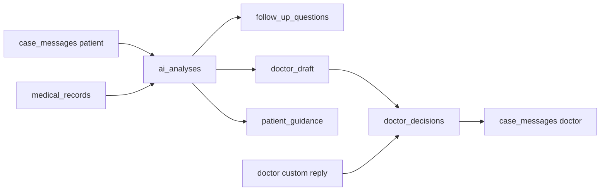

# MedFlow — schema DB (Supabase PostgreSQL)

**Migrations:** `001_initial_schema.sql` → `002_post_consultation_fixes.sql`  
Apply in order via Supabase SQL Editor. Do not re-edit applied migrations; add new ones.

**Backend (current):** MedFlow-Backend is **Node.js + Express** and uses `SUPABASE_SECRET_KEY` (service role). That key **bypasses RLS**, so FastAPI/Express authorization checks are mandatory on every medical request. Intended long-term stack may include Python + FastAPI; the security rule is the same.

Identitate + date medicale în același proiect. Gemini nu vede tabelele — doar text pseudonimizat din gateway.

## Grafic relații

```mermaid
erDiagram
  auth_users ||--|| profiles : "id"
  profiles ||--o{ doctor_patient_assignments : "doctor_id"
  profiles ||--o{ doctor_patient_assignments : "patient_id"
  profiles ||--o{ medical_records : "patient_id"
  profiles ||--o{ cases : "patient_id"
  profiles ||--o{ cases : "doctor_id"
  profiles ||--o{ doctor_decisions : "doctor_id"
  profiles ||--o{ medical_documents : "uploaded_by"

  cases ||--o{ case_messages : "case_id"
  cases ||--o{ medical_documents : "case_id"
  cases ||--o{ ai_analyses : "case_id"
  cases ||--o{ doctor_decisions : "case_id"
  cases ||--o{ cloud_disclosures : "case_id"
  ai_analyses ||--o| doctor_decisions : "ai_analysis_id"
  case_messages ||--o{ ai_analyses : "summarized_until_message_id"

  auth_users {
    uuid id PK
  }

  profiles {
    uuid id PK_FK
    text full_name
    text role "patient | doctor"
    timestamptz created_at
  }

  doctor_patient_assignments {
    uuid id PK
    uuid doctor_id FK
    uuid patient_id FK
    boolean is_active
    timestamptz created_at
  }

  medical_records {
    uuid id PK
    uuid patient_id FK
    text record_type
    jsonb clinical_data
    timestamptz created_at
  }

  cases {
    uuid id PK
    uuid patient_id FK
    uuid doctor_id FK
    text status
    timestamptz created_at
    timestamptz updated_at
  }

  case_messages {
    uuid id PK
    uuid case_id FK
    text sender_role
    text content
    timestamptz created_at
  }

  medical_documents {
    uuid id PK
    uuid case_id FK
    uuid uploaded_by FK
    text document_type
    text mime_type
    bigint size_bytes
    jsonb extracted_data
    timestamptz created_at
  }

  ai_analyses {
    uuid id PK
    uuid case_id FK
    text model_name
    text case_summary
    jsonb symptoms
    jsonb context_relevance
    text patient_guidance
    text doctor_draft
    uuid summarized_until_message_id FK
    text urgency
    jsonb follow_up_questions
    jsonb proposed_options
    text status
    timestamptz created_at
  }

  doctor_decisions {
    uuid id PK
    uuid case_id FK
    uuid doctor_id FK
    uuid ai_analysis_id FK
    text decision_type
    text final_response
    timestamptz created_at
  }

  cloud_disclosures {
    uuid id PK
    uuid case_id FK
    text provider
    text model_name
    text payload_hash
    timestamptz created_at
  }
```

## Flux post-consultație (MVP)



1. Mesajele pacientului se salvează cronologic în `case_messages`.
2. AI produce sumar (`case_summary`), simptome (`symptoms`), relevanță istoric (`context_relevance`), întrebări (`follow_up_questions`), ghidaj general (`patient_guidance`), draft opțional (`doctor_draft`).
3. `summarized_until_message_id` marchează până unde a fost citit chat-ul.
4. Medicul aprobă/editează draft-ul sau scrie independent (`decision_type = 'custom'`, `ai_analysis_id` nullable).
5. AI **nu** diagnostichează / nu prescrie; urgența e etichetă organizațională, nu diagnostic.

## Statusuri & enum-uri

| Tabel | Câmp | Valori |
|-------|------|--------|
| `profiles` | `role` | `patient`, `doctor` |
| `cases` | `status` | `draft`, `awaiting_patient`, `pending_doctor`, `approved`, `closed` |
| `case_messages` | `sender_role` | `patient`, `doctor`, `ai`, `system` |
| `doctor_decisions` | `decision_type` | `approved`, `modified`, `custom`, `rejected` |
| `medical_documents` | `document_type` | `prescription`, `lab_result`, `medical_letter`, `other` |
| `medical_documents` | `mime_type` | `application/pdf`, `image/png`, `image/jpeg` (sau NULL pe rânduri vechi) |
| `ai_analyses` | `status` | `pending` (default), `completed`, `failed` |
| `ai_analyses` | `urgency` | `routine`, `review_required`, `potential_emergency` (nullable) |

### Urgency vocabulary

La review (2026-11-06) **MedFlow-AI** nu definește un contract partajat pentru `urgency` (are `redFlagsDetected` separat pe edge).  
Vocabularul de mai sus este **organizațional** (triage intern pentru medic), **nu** diagnostic autonom.  
Escaladarea critică necesită reguli explicite (ex. `edge/safety/redflags.ts`) + validare medicală — nu doar output LLM.

Coordonare: dacă AI/Backend adoptă alte string-uri, actualizați CHECK-ul într-o migrare nouă **înainte** de a scrie valori incompatibile.

### `proposed_options`

Păstrat din 001 ca **legacy / optional**. Workflow-ul post-consultație **nu** cere 3 propuneri de diagnostic. Câmpurile noi de sumar/draft acoperă MVP-ul.

## medical_documents (upload metadata)

| Coloană | Note |
|---------|------|
| `document_type` | **Categorie medicală**, nu extensie fișier |
| `mime_type` | Tipul fișierului original (MVP MIME-uri de mai sus) |
| `size_bytes` | Dimensiune ≥ 0; nullable pe legacy |
| `uploaded_by` | FK → `profiles.id`; rolul = `profiles.role` |

Backend **trebuie** să populeze metadata la fiecare upload nou și să verifice că uploader-ul are acces la caz (pacientul cazului sau medicul asignat).  
Stocarea fișierelor / OCR nu fac parte din schema DB MVP.

## Authorization (Backend) — nu e enforce-uit pe rol în DB

FK-urile garantează doar că `profiles` există. **DB nu verifică** dacă `doctor_id` e doctor sau `patient_id` e pacient.

Backend trebuie să verifice la fiecare request relevant:

- `doctor_id` → `profiles.role = 'doctor'`
- `patient_id` → `profiles.role = 'patient'`
- medicul are `doctor_patient_assignments` activă pentru pacient
- accesul la caz / documente / decizii respectă asignarea

Hardening viitor (opțional): trigger/CHECK pe rol — **nu** în MVP 24h.

Cheia secretă Supabase bypass RLS → **nu sări** peste autorizarea din Backend.

## Securitate

- RLS ON (+ FORCE) pe tabelele medicale (din 001); coloanele noi moștenesc RLS la nivel de tabel.
- Fără politici publice medicale; `REVOKE` pe `anon`/`authenticated`; `GRANT` pe `service_role`.
- `set_cases_updated_at()` (002): `SET search_path = ''` (Security Advisor).

## Note

- `doctor_patient_assignments`: o alocare **activă** unică per pereche.
- Doar date sintetice în dezvoltare.
- `cloud_disclosures`: metadata (`payload_hash`), fără payload PII brut.
